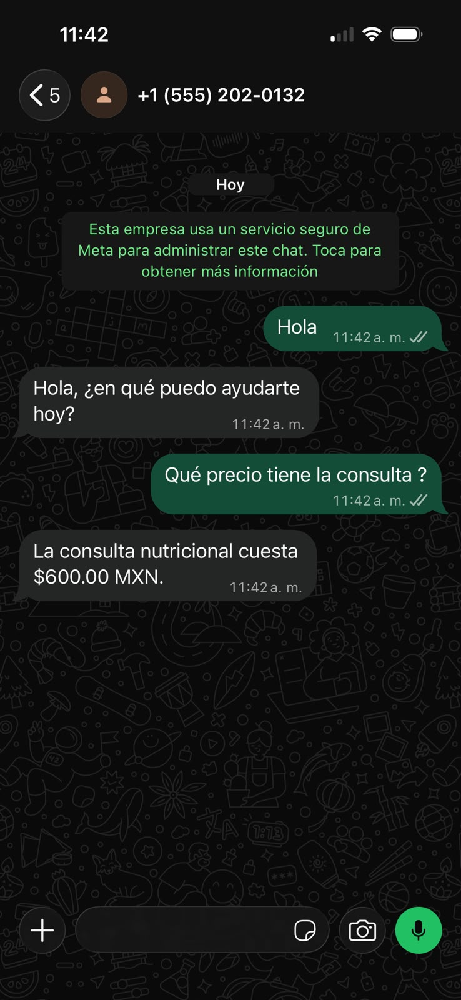
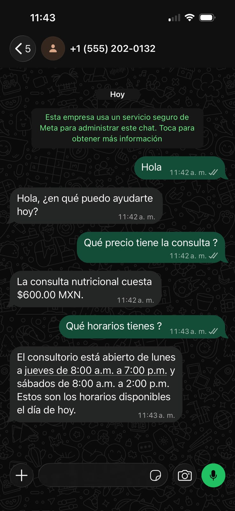
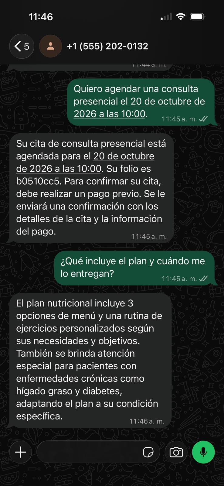

# NutriBot

Agente de WhatsApp para un consultorio de nutrición: responde preguntas frecuentes y agenda citas con **RAG** (búsqueda en `docs/rag.md`) y **function calling** (consultar el reglamento, consultar disponibilidad, agendar y reagendar). Usa **Llama 3.1 8B** como LLM y **Llama Guard 3** como capa de seguridad, todo ejecutándose con **Ollama** localmente.

## Requisitos previos

- macOS / Linux con `conda` (Miniconda o Anaconda) y `ollama` instalados.
- Modelos de Ollama (la primera vez tarda en descargar):

  ```bash
  ollama pull llama3.1:8b
  ollama pull llama-guard3
  ```

## Configuración

```bash
# 1. Entorno conda
conda create -n nutribot python=3.11 -y
conda activate nutribot

# 2. Dependencias
pip install -r requirements.txt

# 3. Variables de entorno (copia el ejemplo y completa)
cp .env.example .env
# edita .env y rellena VERIFY_TOKEN, WHATSAPP_TOKEN, PHONE_ID
```

## Ejecutar el servidor

Necesitas **dos terminales**:

```bash
# Terminal 1 — Ollama
ollama serve

# Terminal 2 — FastAPI
conda activate nutribot
uvicorn app.main:app --reload --host 0.0.0.0 --port 8000
```

- API: <http://localhost:8000>
- Swagger (documentación interactiva): <http://localhost:8000/docs>
- OpenAPI JSON: <http://localhost:8000/openapi.json>
- Health check: `GET /health` → `{"status":"ok","servicio":"nutribot"}`

### Configurar el webhook en Meta for Developers

La URL pública debe apuntar a `https://<tu-túnel>/webhook` con el `VERIFY_TOKEN` definido en tu `.env`. Para exponer el puerto local puedes usar `ngrok`:

```bash
ngrok http 8000
```

Copia la URL HTTPS resultante y agrégala como **Callback URL** en la configuración del webhook de la app de Meta.

## Ejecutar las pruebas

```bash
conda activate nutribot
pytest -q
```

Las pruebas mockean Ollama y WhatsApp, así que **no necesitas tener `ollama` corriendo ni credenciales reales** para ejecutarlas.

Consulta [ejemplos de conversación por WhatsApp](docs/ejemplos_whatsapp.md) para ver mensajes de ejemplo y el tipo de respuesta esperado.

## Capturas de pruebas reales

Estas capturas muestran al bot trabajando durante pruebas reales por WhatsApp:







## Endpoints

| Método | Ruta       | Descripción                                  |
|--------|------------|----------------------------------------------|
| GET    | `/health`  | Health check                                 |
| GET    | `/webhook` | Verificación del webhook (hub.verify_token)  |
| POST   | `/webhook` | Recepción de eventos de WhatsApp Cloud API   |

Todos aparecen documentados en `/docs`.

## Estructura del proyecto

```
app/
  main.py       FastAPI: webhook, /health, lifespan
  config.py     Carga de .env y constantes de reglas de negocio
  rag.py        Búsqueda por embeddings en docs/rag.md
  tools.py      Herramientas del reglamento y de citas
  guard.py      Wrapper de Llama Guard 3 (Ollama)
  memory.py     Historial por número de teléfono (con lock)
  agent.py      Loop de function calling con Ollama
  whatsapp.py   Envío de respuestas a Meta Cloud API
tests/
  test_rag.py    Pruebas del RAG (con codificador simulado)
  test_tools.py  Pruebas de reglas de horario y anticipación
  test_guard.py  Pruebas del wrapper de Llama Guard
  test_api.py    Pruebas del webhook, dedupe por wamid y Swagger
docs/
  rag.md         Base de conocimiento para el RAG
  context        Contexto del proyecto
  prompt         Brief de los documentos de SDD
specs/
  001-init/spec.md   Especificación de la iteración inicial
```

## Reglas de negocio (resumen)

- **Horario de atención**: lunes a jueves 8:00–19:00, sábados 8:00–14:00. No se atiende viernes ni domingos.
- **Anticipación**: las citas (y reagendas) requieren al menos **24 h** de anticipación.
- **Pago**: se realiza por adelantado; el bot lo recuerda al confirmar la cita.
- **Seguridad**: todo mensaje pasa por Llama Guard antes de llegar al LLM, y la salida se vuelve a revisar.
- **Memoria**: una conversación por número; los duplicados de Meta (mismo `wamid`) se ignoran.